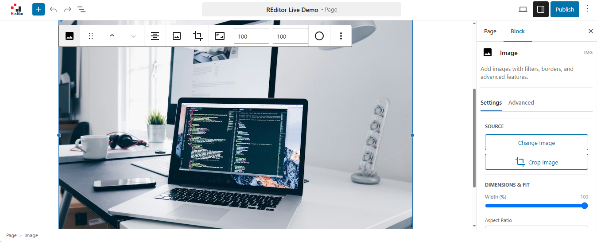

# 🚀 REditor - Framework-Agnostic Visual Block Editor (WYSIWYG)

> **A lightweight, plug-and-play, fully independent page builder alternative to Gutenberg.**

**REditor** (Rapid, Responsive, Reliable) is a modern visual block editor and page builder designed to bridge the gap between heavy, ecosystem-locked editors (like WordPress Gutenberg) and non-visual JSON-based editors (like Editor.js). Built with a pure ES6 JavaScript core and an isolated `iframe` canvas, it integrates into any backend language (PHP, Node.js, Python, Go) or frontend framework (Laravel, WordPress, Vue, React) in minutes.

---
<div align="center">

  

  # REditor
  
  **A lightweight, framework-agnostic visual block editor built with pure ES6 JavaScript and an isolated iframe canvas.**

  [](https://vivonza.github.io/reditor-demo/)
  [](LICENSE)
  [](https://mockpackstudio.gumroad.com/l/reditor)

</div>

---
## 📑 Table of Contents

- [Key Features](#-key-features)
- [Quick Start](#-quick-start)
- [Build Commands](#-build-commands)
- [Configuration Reference (`REditor.boot`)](#-configuration-reference-reditorboot)
- [Output Formats (`post_content` vs `blocks_json`)](#-output-formats-post_content-vs-blocks_json)
- [JavaScript API & Events](#-javascript-api--events)
- [Dynamic Right Sidebar (`documentSettings`)](#-dynamic-right-sidebar-documentsettings)
- [API Contracts (Media & Templates)](#-api-contracts-media--templates)
- [Backend & Media Integration Examples](#-backend--media-integration-examples)
  - [1. PHP](#1-php-publicapiupdatephp)
  - [2. Laravel](#2-laravel-controller--blade)
  - [3. WordPress](#3-wordpress-native-wpmedia-or-wp-rest-adapter)
  - [4. Node.js (Express + Multer)](#4-nodejs-express--multer)
  - [5. S3 / Cloudflare R2 / GCS](#5-s3--cloudflare-r2--gcs-signed-url)
  - [6. Zero-Backend / Static Demo](#6-zero-backend--static-demo-mode)
- [License](#-license)

---

## ✨ Key Features

* **🔌 Framework-Agnostic & Event-Driven:** Communicates with host applications via a clean JS API (`REditor.onSave`, `REditor.onChange`) and `CustomEvent` architecture (`reditor:save`, `reditor:preview`, `reditor:trash`) without forcing full-page reloads.
* **🚀 Simple Gutenberg-Style Bootloader (`REditor.boot`):** Initialize the editor with a single clean `REditor.boot('#reditor-app', { ... })` call inside a `<script type="module">` block.
* **🧠 Single Source of Truth Config (`config.js`):** All settings are deep-merged in a central store (`REditor.getConfig()` / `REditor.setConfig()`), with automatic backward compatibility for legacy `window.DYNAMIC_SERVER_CONFIG` or `window.EDITOR_CONFIG` setups.
* **💾 Flexible Save Formats (`HTML`, `JSON`, or `Both`):** Export clean HTML (`post_content`), structured block JSON (`blocks_json`), or both—and convert `blocks_json` back to HTML or reload it into the editor anytime via `REditor.setBlocks()` and `REditor.blocksToHtml()`.
* **🔄 Two-Way Gutenberg Compatibility:** Reads, parses, and exports standard Gutenberg block comments (`<!-- re:paragraph -->` or `<!-- wp:paragraph -->`) as clean, semantic HTML.
* **🌍 Multi-Language & Full RTL Support:** Built-in i18n with automatic RTL mirroring for Arabic (`ar`), Hebrew, Persian, and Urdu.
* **🖼️ Backend-Agnostic Media & Video Layer (`MediaService`):**
  * Supports **REST APIs** (`apiEndpoints`), **Custom JS Adapters** (`media.adapter` for S3, R2, WordPress REST, Firebase), or **Zero-Backend In-Memory Mode**.
  * Smart filtering by file type, date (`YYYY-MM`), **"Mine"** (`currentUserId`), and **"Uploaded to this post"**.
  * Live metadata autosave (title, alt text, caption, description) with an 800ms debounce.
  * Native WordPress media library hook (`wp.media`) when running inside WP.
* **🎨 True 1:1 Visual Editing (Isolated Iframe Canvas):** Injects your site's frontend CSS files (`themeStyles`) directly into the isolated canvas with automatic selector scoping.
* **📐 Dynamic Document Sidebar & Template System:** Build custom right-sidebar document settings (`slug`, `select`, `radio`, `textarea`, `checkbox`, `datetime-local`) via JSON or remote API (`optionsUrl`), plus drag-and-drop columns and a "Save as Template" manager.

---

## 🛠️ Quick Start

REditor requires a target container (`#reditor-app`), its bundle stylesheet, React globals, and the main ES module script.  
> **Important:** Because `editor.bundle.js` (or `js/main.js`) is loaded as an ES module (`type="module"`), your initialization block must also use `<script type="module">` so it executes in exact order after REditor loads.

```html
<!DOCTYPE html>
<html lang="en">
<head>
    <meta charset="UTF-8">
    <meta name="csrf-token" content="YOUR_SECURITY_TOKEN_HERE">
    <title>REditor Integration</title>
    
    <!-- 1. Editor Bundle Stylesheet -->
    <link rel="stylesheet" href="dist/reditor/reditor.bundle.css">
</head>
<body>

    <!-- 2. Main Container (Can be inside a <form> for traditional POST) -->
    <form id="post-form" action="/posts/save" method="POST">
        <div id="reditor-app"></div>
    </form>

    <!-- 3. React Dependencies & Main Editor Bundle -->
    <script src="public/vendor/react.production.min.js"></script>
    <script src="public/vendor/react-dom.production.min.js"></script>
    <script type="module" src="dist/reditor/reditor.bundle.js"></script>

    <!-- 4. Initialize REditor -->
    <script type="module">
        REditor.boot('#reditor-app', {
            lang: "en",
            assetsBaseUrl: "public",
            csrfToken: document.querySelector('meta[name="csrf-token"]')?.content || '',
            currentUserId: 1,
            showLogo: true,
            titleMode: "inline", // 'inline' | 'modal' | 'header'
            contentType: "page",
            initialTitle: "Hello World",
            initialContent: `<!-- re:paragraph --><p>REditor is ready to use!</p><!-- /re:paragraph -->`,
            saveFormat: "both", // 'both' | 'html' | 'json'

            // Template & Pattern Endpoints
            templatesUrl: "public/data/templates.json",
            saveTemplateUrl: "public/api/save-templates.php",
            deleteTemplateUrl: "public/api/delete-template.php",

            // Dynamic Right Sidebar Settings (JSON file or API endpoint)
            editorConfigUrl: "public/data/editor-config.json",

            // Inject Frontend CSS into the Editor Canvas
            themeStyles: [
                "http://localhost:5173/public/tema_css/bundle.css",
                "http://localhost:5173/public/tema_css/style.css"
            ],

            trashUrl: "delete.php",
            previewMode: true,
            previewUrl: "preview.php",
            draftMode: true,

            media: {
                maxUploadSize: "10 MB",
                useRealBackend: true,
                apiEndpoints: {
                    list: "public/api/list.php",
                    upload: "public/api/upload.php",
                    delete: "public/api/delete.php",
                    update: "public/api/update.php"
                }
            }
        });
    </script>
</body>
</html>
```

---

## 📦 Build Commands

```bash
# PHP / WordPress / Standard Bundle
npm run build

# React / Vue / SPA Library Mode
npx vite build --mode lib
```

---

## ⚙️ Configuration Reference (`REditor.boot`)

| Parameter | Type | Default | Description |
| :--- | :--- | :--- | :--- |
| `lang` | `String` | `'en'` | UI language (`'en'`, `'tr'`, `'de'`, `'fr'`, `'es'`, `'ar'`, `'ru'`, `'pt'`, `'it'`). Defaults to English if omitted. |
| `assetsBaseUrl` | `String` | `'./public'` | Base path for static assets and external language files (`{assetsBaseUrl}/editor/lang`). |
| `csrfToken` | `String` | `''` | Security token automatically sent as `X-CSRF-TOKEN` and `X-WP-Nonce` headers. |
| `currentUserId` | `Number\|String` | `null` | Active user ID, required for the **"Mine"** filter in the Media Library. |
| `showLogo` | `Boolean` | `true` | Shows or hides the REditor brand logo in the top-left toolbar. |
| `titleMode` | `String` | `'inline'` | Title editing mode: `'inline'` (inside canvas), `'modal'` (popup dialog), or `'header'`. |
| `contentType` | `String` | `'page'` | Document label displayed in the header and footer breadcrumb (`'page'`, `'post'`). |
| `initialTitle` | `String` | `''` | Initial document title. |
| `initialContent` | `String` | `''` | Initial HTML or Gutenberg-style block markup. |
| `saveFormat` | `String` | `'both'` | Controls form POST output: `'both'` (`post_content` + `blocks_json`), `'html'` (`post_content` only), or `'json'` (`blocks_json` only). |
| `editorConfig` | `Object` | `undefined` | Inline JSON object defining dynamic right-sidebar `documentSettings`. |
| `editorConfigUrl` | `String` | `''` | URL to fetch `documentSettings` JSON asynchronously. |
| `templatesUrl` | `String` | `''` | URL to fetch block templates/patterns JSON. |
| `saveTemplateUrl` | `String` | `''` | `POST` endpoint to save custom user templates. |
| `deleteTemplateUrl` | `String` | `''` | `POST` endpoint to delete custom user templates. |
| `previewMode` | `Boolean` | `false` | Enables or disables the **Preview** button. |
| `previewUrl` | `String` | `''` | URL opened when clicking Preview (`GET` via `sessionStorage` or `POST` form). |
| `previewMethod` | `String` | `'POST'` | `'GET'` (uses `sessionStorage`) or `'POST'` (submits hidden form). |
| `onPreview` | `Function` | `null` | Custom callback function triggered when Preview is clicked. |
| `draftMode` | `Boolean` | `true` | Enables or disables the **Save Draft** button. |
| `trashUrl` | `String` | `''` | Redirect URL when "Move to Trash" is confirmed. |
| `imageProxyUrl` | `String` | `''` | Optional same-origin proxy endpoint (`?url=...`) to bypass CORS in the image cropper. |
| `themeStyles` | `Array` | `[]` | Frontend CSS URLs scoped and injected into the isolated iframe canvas. |
| `autosaveKey` | `String` | `pathname` | Custom `localStorage` key suffix for draft recovery. |
| `media.useRealBackend` | `Boolean` | `true` | `true` uses REST `apiEndpoints`; `false` uses the in-memory mock adapter. |
| `media.adapter` | `Object` | `undefined` | Custom JS adapter (`{ capabilities, list, upload, remove, update }`) for S3, WP, etc. |

---

## 💾 Output Formats (`post_content` vs `blocks_json`)

When submitting a form (`POST`) or listening to `REditor.onSave()`, REditor generates two representations of your document:

1. **`post_content` (Clean HTML + Gutenberg Block Comments):** Ready-to-render HTML (`<!-- re:paragraph --><p>...</p><!-- /re:paragraph -->`) that can be rendered directly on your frontend without any parser.
2. **`blocks_json` (Structured Block Tree):** A JSON array containing each block's `id`, `type`, and `data` properties (styles, alignment, font size, margins, custom classes, etc.)—ideal for headless APIs, mobile apps, or structured database storage.

### Controlling Which Format is Submitted (`saveFormat`)

```javascript
REditor.boot('#reditor-app', {
    // 'both' (Default) -> Posts both `post_content` (HTML) and `blocks_json` (JSON)
    // 'html'           -> Posts ONLY `post_content` (Best for standard PHP/Laravel/WP sites)
    // 'json'           -> Posts ONLY `blocks_json` (Best for headless/API-driven architectures)
    saveFormat: 'both'
});
```

### Restoring & Converting `blocks_json`

If you store `blocks_json` in your database, you can load it back into the editor or convert it into clean HTML without affecting the active editor canvas:

```javascript
// 1. Load saved blocks_json directly into the active editor
REditor.setBlocks(savedBlocksJson);

// Or load both title and blocks together (e.g., switching posts in an SPA)
REditor.setBlocks({
    title: 'Post Title from DB',
    blocks: savedBlocksJson
});

// 2. Convert blocks_json into clean HTML in memory (non-destructive to active canvas)
const cleanHtml = REditor.blocksToHtml(savedBlocksJson);
```

---

## 🎛️ JavaScript API & Events

Control REditor programmatically via `window.REditor` or ES module imports:

```javascript
import { mountReditor, destroyReditor, getContent, setContent, setBlocks, blocksToHtml, onChange, onSave } from './js/main.js';
```

### Programmatic Methods

```javascript
// 1. Get current title, clean HTML, and structured blocks array
const { title, html, blocks, isDirty } = REditor.getContent();

// 2. Load new HTML content dynamically
REditor.setContent({
    title: 'Updated Post Title',
    html: '<!-- re:paragraph --><p>New content loaded.</p><!-- /re:paragraph -->'
});

// 3. Load structured blocks_json dynamically
REditor.setBlocks({
    title: 'Loaded from JSON',
    blocks: savedBlocksJson
});

// 4. Convert blocks_json to HTML string without modifying the canvas
const htmlOutput = REditor.blocksToHtml(savedBlocksJson);

// 5. Listen for content changes
const unsubscribeChange = REditor.onChange(() => {
    console.log('Editor content modified!');
});

// 6. Intercept Save / Publish (Replaces default <form> submission)
const unsubscribeSave = REditor.onSave(async ({ status, title, html, blocks }) => {
    await fetch('/api/posts/save', {
        method: 'POST',
        headers: { 'Content-Type': 'application/json' },
        body: JSON.stringify({ status, title, html, blocks })
    });
});

// 7. Cleanly unmount and destroy instance (for React/Vue component unmount)
REditor.destroy('#reditor-app');
```

### DOM CustomEvents

| Event | Cancelable | `e.detail` Payload | Description |
| :--- | :--- | :--- | :--- |
| `reditor:save` | Yes | `{ status, title, html, blocks, done }` | Fired on Publish/Save Draft. Call `done(true)` or `done(false)` when async save completes. |
| `reditor:preview` | Yes | `{}` | Fired before default preview routing. |
| `reditor:trash` | Yes | `{}` | Fired after user confirms moving the document to trash. |
| `reditor:template-saved` | No | `{ template, category, allTemplates }` | Fired when a block is saved as a reusable template. |
| `reditor:change` | No | `{}` | Fired whenever canvas blocks or document title change. |

---

## 🧩 Dynamic Right Sidebar (`documentSettings`)

Configure custom document metadata fields in the right sidebar via `editorConfig` or `editorConfigUrl`.  
Supported `inputType` values: `radio`, `select`, `textarea`, `slug`, `text`, `number`, `date`, `datetime-local`, and row-level `checkbox` / `toggle`.

```json
{
    "documentSettings": [
        {
            "id": "post_status",
            "label": "Status",
            "type": "popup",
            "defaultValue": "draft",
            "popupId": "statusPopup",
            "hiddenInput": "#hidden_post_status",
            "popupContent": {
                "title": "Select Status",
                "inputType": "radio",
                "options": [
                    { "value": "draft", "label": "Draft" },
                    { "value": "publish", "label": "Published" }
                ]
            }
        },
        {
            "id": "post_slug",
            "label": "URL Slug",
            "type": "popup",
            "defaultValue": "hello-world",
            "hiddenInput": "#hidden_post_slug",
            "popupContent": {
                "title": "Permalink Slug",
                "inputType": "slug",
                "baseUrl": "https://example.com/",
                "description": "Customize the last part of the URL."
            }
        },
        {
            "id": "category_id",
            "label": "Category",
            "type": "popup",
            "hiddenInput": "#hidden_category_id",
            "popupContent": {
                "title": "Select Category",
                "inputType": "select",
                "optionsUrl": "/api/v1/categories",
                "valueKey": "id",
                "labelKey": "name"
            }
        }
    ]
}
```

> **Note:** When submitting via a standard `<form>`, REditor automatically syncs all `documentSettings` values into hidden `<input>` elements matching their `id`.

---

## 📋 API Contracts (Media & Templates)

### Media REST Endpoints (`media.apiEndpoints`)

| Action | HTTP Request | Expected JSON Response |
| :--- | :--- | :--- |
| **List** | `GET list?page=1&search=&type=image&date=2026-11` | `{ "data": [...], "current_page": 1, "last_page": 5 }` |
| **Upload** | `POST upload` (`FormData` with `file` field) | `{ "success": true, "data": { "id": 1, "url": "...", "mime_type": "..." } }` |
| **Delete** | `POST delete` JSON `{ "id": 1, "filename": "...", "item_url": "..." }` | `{ "success": true }` |
| **Update** | `POST update` JSON `{ "id": 1, "alt_text": "..." }` | `{ "success": true }` |

#### Media Item Schema

```json
{
    "id": 17691,
    "user_id": 1,
    "filename": "hero_image.jpg",
    "original_name": "hero_image.jpg",
    "title": "Hero Image",
    "alt_text": "SEO Alt Text",
    "caption": "Image caption",
    "description": "Detailed description",
    "url": "https://example.com/uploads/hero_image.jpg",
    "thumbnail_url": "https://example.com/uploads/thumb_hero_image.jpg",
    "mime_type": "image/jpeg",
    "size": 245120,
    "created_at": "2026-11-05 12:00:00"
}
```

### Save Template Payload (`POST -> saveTemplateUrl`)

```json
{
    "category": "Hero Sections",
    "template": {
        "id": 1700000000000,
        "slug": "modern-hero-1700000000000",
        "title": "Modern Hero",
        "type": "group",
        "description": "Custom saved block",
        "content": "<!-- re:group --><div>...</div><!-- /re:group -->"
    }
}
```

**Expected Response:** `{ "success": true }` with HTTP `200 OK`.

---

## 🔌 Backend & Media Integration Examples

### 1. PHP (`public/api/update.php`)

For a lightweight PHP setup, `list.php`, `upload.php`, `delete.php`, and `update.php` handle all media operations:

```php
<?php
require __DIR__ . '/config.php';
header('Content-Type: application/json; charset=utf-8');

$in = json_decode(file_get_contents('php://input'), true) ?: [];
$id = $in['id'] ?? null;
if ($id === null) {
    http_response_code(400);
    echo json_encode(['success' => false, 'error' => 'id required']);
    exit;
}

$allowed = ['alt_text', 'title', 'caption', 'description'];
$data = json_decode(file_get_contents(MEDIA_JSON), true) ?: ['data' => []];
$found = false;

foreach ($data['data'] as &$it) {
    if ((string)$it['id'] === (string)$id) {
        foreach ($allowed as $k) {
            if (array_key_exists($k, $in)) $it[$k] = $in[$k];
        }
        $it['updated_at'] = date('Y-m-d\TH:i:s\Z');
        $found = true;
        break;
    }
}
unset($it);

if (!$found) {
    http_response_code(404);
    echo json_encode(['success' => false, 'error' => 'not found']);
    exit;
}

file_put_contents(
    MEDIA_JSON,
    json_encode($data, JSON_PRETTY_PRINT | JSON_UNESCAPED_SLASHES | JSON_UNESCAPED_UNICODE),
    LOCK_EX
);
echo json_encode(['success' => true]);
```

---

### 2. Laravel (Controller & Blade)

Laravel's `paginate()` output already matches `data`, `current_page`, and `last_page`. Always return full URLs (`url(Storage::disk('public')->url($path))`).

**`app/Http/Controllers/EditorMediaController.php`:**

```php
<?php

namespace App\Http\Controllers;

use App\Models\Media;
use Illuminate\Http\Request;
use Illuminate\Support\Facades\Storage;

class EditorMediaController extends Controller
{
    private function toItem(Media $m): array
    {
        $url = url(Storage::disk('public')->url($m->path));
        return [
            'id' => $m->id,
            'user_id' => $m->user_id,
            'filename' => basename($m->path),
            'original_name' => $m->original_name,
            'mime_type' => $m->mime_type,
            'title' => $m->title,
            'alt_text' => $m->alt_text,
            'caption' => $m->caption,
            'description' => $m->description,
            'size' => $m->size,
            'url' => $url,
            'thumbnail_url' => $url,
            'created_at' => $m->created_at?->toIso8601String(),
        ];
    }

    public function index(Request $r)
    {
        $q = Media::query()->latest();

        if ($s = $r->query('search')) {
            $q->where(fn ($w) => $w->where('title', 'like', "%$s%")->orWhere('original_name', 'like', "%$s%"));
        }
        if ($t = $r->query('type')) {
            $q->where('mime_type', 'like', $t . '/%');
        }
        if (($d = $r->query('date')) && preg_match('/^(\d{4})-(\d{2})$/', $d, $m)) {
            $q->whereYear('created_at', $m[1])->whereMonth('created_at', $m[2]);
        }

        $page = $q->paginate(40)->through(fn ($m) => $this->toItem($m));
        $dates = Media::query()->latest()->pluck('created_at')->map(fn ($c) => $c->format('Y-m'))->unique()->values();

        return response()->json($page->toArray() + ['dates' => $dates]);
    }

    public function upload(Request $r)
    {
        $r->validate(['file' => 'required|file|max:10240|mimes:jpg,jpeg,png,gif,webp,mp4,webm,mp3,wav,pdf']);
        $f = $r->file('file');

        $media = Media::create([
            'user_id' => $r->user()->id,
            'path' => $f->store('media', 'public'),
            'original_name' => $f->getClientOriginalName(),
            'mime_type' => $f->getMimeType(),
            'title' => pathinfo($f->getClientOriginalName(), PATHINFO_FILENAME),
            'size' => $f->getSize(),
        ]);

        return response()->json(['success' => true, 'data' => $this->toItem($media)]);
    }

    public function destroy(Request $r)
    {
        $media = Media::findOrFail($r->input('id'));
        Storage::disk('public')->delete($media->path);
        $media->delete();
        return response()->json(['success' => true]);
    }

    public function update(Request $r)
    {
        $media = Media::findOrFail($r->input('id'));
        $media->update($r->only(['alt_text', 'title', 'caption', 'description']));
        return response()->json(['success' => true]);
    }
}
```

**Saving Post Data in Laravel:**

```php
public function store(Request $request)
{
    $post = new Post();
    $post->post_title = $request->input('post_title');
    $post->post_content = $request->input('post_content'); // Clean HTML (when saveFormat is 'both' or 'html')
    $post->blocks_json = $request->input('blocks_json');   // Structured JSON (when saveFormat is 'both' or 'json')
    $post->post_status = $request->input('post_status', 'publish');
    $post->slug = $request->input('post_slug');
    $post->category_id = $request->input('category_id');
    $post->save();

    return redirect()->back()->with('success', 'Saved successfully.');
}
```

---

### 3. WordPress (Native `wp.media` or WP REST Adapter)

* **Option A (Built-in):** If `wp.media` is loaded on the admin page, REditor automatically opens the native WordPress Media Modal.
* **Option B (REditor Modal + WP REST API):** Pass a custom `media.adapter` to `REditor.boot()`:

```javascript
const WP = '/wp-json/wp/v2/media';
const nonce = () => window.wpApiSettings?.nonce || '';
const plain = (h) => (h || '').replace(/<[^>]+>/g, '').trim();

const toItem = (m) => ({
    id: m.id,
    url: m.source_url,
    thumbnail_url: m.media_details?.sizes?.thumbnail?.source_url || m.source_url,
    filename: m.source_url.split('/').pop(),
    original_name: m.slug,
    mime_type: m.mime_type,
    title: plain(m.title?.rendered),
    alt_text: m.alt_text || '',
    caption: plain(m.caption?.rendered),
    description: plain(m.description?.rendered),
    size: m.media_details?.filesize,
    user_id: m.author,
    created_at: m.date_gmt ? m.date_gmt + 'Z' : m.date
});

async function wpFetch(url, opts = {}) {
    const r = await fetch(url, {
        credentials: 'same-origin',
        ...opts,
        headers: { 'X-WP-Nonce': nonce(), ...(opts.headers || {}) }
    });
    if (!r.ok) throw new Error(`Server error (${r.status})`);
    return r;
}

REditor.boot('#reditor-app', {
    lang: 'en',
    media: {
        adapter: {
            capabilities: { search: true, type: true, date: true, pagination: true },
            async list({ page = 1, search, type, date }) {
                const p = new URLSearchParams({ page, per_page: 40, orderby: 'date', order: 'desc' });
                if (search) p.set('search', search);
                if (['image', 'video', 'audio', 'application'].includes(type)) p.set('media_type', type);
                if (date && date !== 'all') {
                    const [y, m] = date.split('-').map(Number);
                    p.set('after', new Date(Date.UTC(y, m - 1, 1)).toISOString());
                    p.set('before', new Date(Date.UTC(y, m, 1)).toISOString());
                }
                const r = await wpFetch(`${WP}?${p}`);
                return {
                    data: (await r.json()).map(toItem),
                    current_page: page,
                    last_page: Number(r.headers.get('X-WP-TotalPages')) || page
                };
            },
            async upload(file) {
                const fd = new FormData();
                fd.append('file', file);
                const r = await wpFetch(WP, { method: 'POST', body: fd });
                return { success: true, data: toItem(await r.json()) };
            },
            async remove(item) {
                await wpFetch(`${WP}/${item.id}?force=true`, { method: 'DELETE' });
                return { success: true };
            },
            async update(item, fields) {
                await wpFetch(`${WP}/${item.id}`, {
                    method: 'POST',
                    headers: { 'Content-Type': 'application/json' },
                    body: JSON.stringify(fields)
                });
                return { success: true };
            }
        }
    }
});
```

---

### 4. Node.js (Express + Multer)

```javascript
import express from 'express';
import multer from 'multer';
import cors from 'cors';
import fs from 'node:fs';

const app = express();
app.use(cors());
app.use(express.json());
app.use('/uploads', express.static('uploads'));

const storage = multer.diskStorage({
    destination: 'uploads',
    filename: (req, f, cb) => cb(null, Date.now() + '_' + f.originalname.replace(/[^\w.-]/g, '_'))
});
const upload = multer({ storage, limits: { fileSize: 10 * 1024 * 1024 } });

let items = [];
const BASE = 'http://localhost:3000';

app.get('/media', (req, res) => {
    const { page = 1, search = '', type = '', date = '' } = req.query;
    let list = items.filter(i =>
        (!search || (i.title + i.original_name).toLowerCase().includes(String(search).toLowerCase())) &&
        (!type || i.mime_type.startsWith(type + '/')) &&
        (!date || i.created_at.startsWith(date))
    );
    const per = 40, total = list.length;
    list = list.slice((page - 1) * per, page * per);
    res.json({
        data: list,
        current_page: Number(page),
        last_page: Math.max(1, Math.ceil(total / per)),
        dates: [...new Set(items.map(i => i.created_at.slice(0, 7)))].sort().reverse()
    });
});

app.post('/media/upload', upload.single('file'), (req, res) => {
    const f = req.file;
    const item = {
        id: Date.now(),
        filename: f.filename,
        original_name: f.originalname,
        mime_type: f.mimetype,
        title: f.originalname.replace(/\.[^.]+$/, ''),
        size: f.size,
        url: `${BASE}/uploads/${f.filename}`,
        thumbnail_url: `${BASE}/uploads/${f.filename}`,
        created_at: new Date().toISOString()
    };
    items.unshift(item);
    res.json({ success: true, data: item });
});

app.post('/media/delete', (req, res) => {
    const it = items.find(i => String(i.id) === String(req.body.id));
    if (it) fs.rm('uploads/' + it.filename, { force: true }, () => {});
    items = items.filter(i => i !== it);
    res.json({ success: true });
});

app.post('/media/update', (req, res) => {
    const { id, ...fields } = req.body;
    const it = items.find(i => String(i.id) === String(id));
    if (it) for (const k of ['alt_text', 'title', 'caption', 'description']) if (k in fields) it[k] = fields[k];
    res.json({ success: true });
});

app.listen(3000);
```

---

### 5. S3 / Cloudflare R2 / GCS (Signed URL)

```javascript
const API = '/api/media';
const auth = () => ({ Authorization: 'Bearer ' + localStorage.getItem('token') });
const postJson = async (url, body) => {
    const r = await fetch(url, {
        method: 'POST',
        headers: { 'Content-Type': 'application/json', ...auth() },
        body: JSON.stringify(body)
    });
    if (!r.ok) throw new Error(`Server error (${r.status})`);
    return r.json();
};

REditor.boot('#reditor-app', {
    media: {
        resolveUrl: (url) => (/^https?:/.test(url) ? url : 'https://cdn.example.com/' + url),
        adapter: {
            capabilities: { search: true, type: true, date: true, pagination: true },
            async list(q) {
                const p = new URLSearchParams(Object.entries(q).filter(([, v]) => v));
                const r = await fetch(`${API}?${p}`, { headers: auth() });
                return r.json();
            },
            async upload(file, { onProgress } = {}) {
                const { uploadUrl, key } = await postJson(`${API}/sign`, {
                    filename: file.name, type: file.type, size: file.size
                });
                await new Promise((resolve, reject) => {
                    const x = new XMLHttpRequest();
                    x.open('PUT', uploadUrl);
                    x.setRequestHeader('Content-Type', file.type);
                    x.upload.onprogress = (e) => e.lengthComputable && onProgress?.(e.loaded / e.total);
                    x.onload = () => (x.status < 300 ? resolve() : reject(new Error('Upload failed ' + x.status)));
                    x.onerror = () => reject(new Error('Network error'));
                    x.send(file);
                });
                const item = await postJson(API, {
                    key, original_name: file.name, mime_type: file.type, size: file.size
                });
                return { success: true, data: item };
            },
            async remove(item) { await postJson(`${API}/delete`, { id: item.id }); return { success: true }; },
            async update(item, fields) { await postJson(`${API}/update`, { id: item.id, ...fields }); return { success: true }; }
        }
    }
});
```

---

### 6. Zero-Backend / Static Demo Mode

If no backend endpoints are provided (or `useRealBackend: false`), `MediaService` automatically falls back to an in-memory store:

```javascript
REditor.boot('#reditor-app', {
    media: {
        useRealBackend: false,
        items: [
            { id: 1, url: 'https://picsum.photos/id/10/800/600', mime_type: 'image/jpeg', title: 'Forest' },
            { id: 2, url: 'https://picsum.photos/id/20/800/600', mime_type: 'image/jpeg', title: 'Desk' }
        ]
    }
});
```

> **Note:** Uploaded files in zero-backend mode use `blob:` URLs that expire on page reload—intended for demos and testing only.

---

## ⚖️ License

REditor uses a **Dual Licensing** model:

1. **Open Source License (GPLv3):** Free to use in open-source and GPLv3-compatible projects.
2. **Commercial License:** Required for closed-source, SaaS, proprietary agency CMS platforms, or paid themes/plugins where you wish to keep your source code private and receive developer support.
